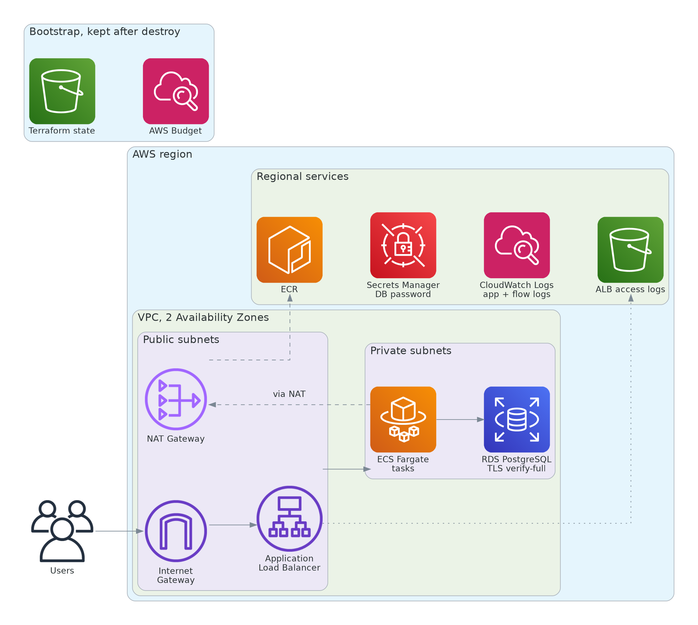

# aws-ecs-production-ready

Production-ready AWS infrastructure for a containerized app, written in Terraform: ECS Fargate behind a load balancer, a private RDS database, secrets in Secrets Manager and a destroy that leaves nothing behind. A small FastAPI and PostgreSQL API is the demo workload.




## What you get

- **Private network in 2 AZs.** Tasks and database run in private subnets with no public IP. Only the load balancer is public.
- **ECS Fargate with automatic rollback.** The deployment circuit breaker returns to the previous task definition when new tasks fail the health check.
- **RDS PostgreSQL with verified TLS.** The server refuses plain connections and the app connects with `verify-full` against the RDS CA bundle.
- **No password in code or state.** RDS generates the master password and keeps it in Secrets Manager. The task gets it at start through its execution role.
- **Migrations as a one-off task.** `make db-migrate` runs Alembic once per release, so tasks starting together never race on the schema.
- **Scanners in one command.** `make scan` runs Trivy and Checkov on the Terraform code and Trivy on the image. Every accepted finding has a written reason.
- **Logs you can use.** The app writes JSON to CloudWatch Logs. VPC Flow Logs and ALB access logs are on.
- **Cheap and removable.** About $0.12 an hour while running, and `make tf-destroy` removes everything except the state bucket and the budget.

## Evidence

One run on an empty account, from `make infra-up` to `make tf-destroy`.

- [Deploy](docs/evidence/deploy.md): 53 resources created and the migration task exiting 0.
- [API through the load balancer](docs/evidence/api.md): health checks, create, list, update and delete, and the JSON log lines those requests produced.
- [State of the environment](docs/evidence/aws-state.md): ECS service running, target healthy, RDS private and encrypted, secret managed by RDS.
- [Scanners](docs/evidence/scan.md): `make scan` with no findings.
- [Destroy](docs/evidence/destroy.md): 53 resources removed, only the state bucket left.

```
$ curl -i $URL/health/db
HTTP/1.1 200 OK
{"status":"ok"}
```

## Cost

| | Per hour | Per month if left running |
|---|---|---|
| `dev` environment (NAT Gateway, ALB, one Fargate task, RDS `db.t4g.micro`) | about $0.12 | about $90 |
| Bootstrap (state bucket and budget), kept after destroy | | under $0.01 |

The environment is meant to be created, validated and destroyed. The full run above took about 20 minutes, around $0.04. The breakdown and the cheaper and costlier options (NAT per AZ, VPC endpoints, WAF) are in the [security and cost review](docs/security-review.md#cost).

## Quickstart

Needs Terraform, the AWS CLI, Docker, GNU Make and a profile for an AWS account.

```bash
export AWS_PROFILE=<your-profile>
cd infra/bootstrap && cp terraform.tfvars.example terraform.tfvars   # set budget_alert_emails
terraform init && terraform apply && cd ../..                         # state bucket and budget, once per account
cd infra/envs/dev && cp backend.hcl.example backend.hcl               # set the bucket from the bootstrap output
cd ../../.. && make infra-up                                          # ECR, image, network, ALB, ECS, RDS, migration
make tf-destroy                                                       # remove everything in dev
```

The [provisioning guide](docs/provisioning-guide.md) covers the bootstrap, the prerequisites, another region and using this repository as the base for a client. To run only the API locally, see [local development](docs/local-development.md).

## Repository layout

| Path | Contents |
|---|---|
| `app/` | Demo API: FastAPI, PostgreSQL, Alembic migrations, tests, Dockerfile |
| `infra/` | Terraform: bootstrap, modules (network, ECR, ALB, ECS service, database) and the `dev` environment ([details](infra/README.md)) |
| `docs/` | [Provisioning guide](docs/provisioning-guide.md), [security and cost review](docs/security-review.md), [local development](docs/local-development.md), evidence, diagram source |

`make help` lists every command. `make diagram` regenerates the diagram from `docs/architecture.py`.

## Security

Scanners run clean, and each accepted finding is suppressed on its resource with a reason. IAM roles are scoped to single resources, and the database password never reaches the code, the state or the logs. The [security and cost review](docs/security-review.md) has every finding, the IAM permissions, the security group rules and the known limitations, such as HTTP only until a domain and certificate exist.

## Roadmap

- CI with GitHub Actions: lint, tests, Terraform checks, image build and scanners on every pull request.
- CD with OIDC: deploy on push to `main` with no AWS keys stored in GitHub, and rollback on a failed deploy.
- Alarms in CloudWatch with SNS notifications, and Grafana dashboards.

## Contact

Available for AWS and Terraform work on Upwork: _profile link coming soon_.

## License

[MIT](LICENSE)
